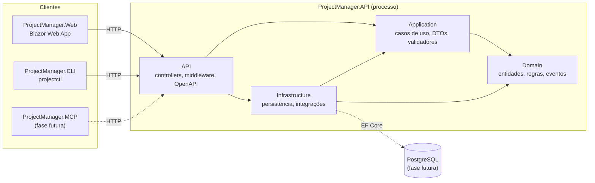

# Arquitetura do ProjectManager

> Estado: Fase 01 (fundação técnica). Decisão de base: [ADR-001 — Monólito modular](../decisions/ADR-001-MODULAR-MONOLITH.md).

## 1. Visão geral

O ProjectManager é um **monólito modular** em .NET 10. Um único processo de API concentra as regras de negócio e a persistência. Os clientes (interface Web, CLI `projectctl` e, no futuro, servidor MCP e integrações) consomem a API **exclusivamente por HTTP**.

## 2. Camadas e dependências

| Projeto | Depende de | Responsabilidade |
|---|---|---|
| `Domain` | — | Entidades, objetos de valor, enums, eventos de domínio, interfaces de domínio, regras de negócio. |
| `Application` | `Domain` | Casos de uso, serviços de aplicação, DTOs, validadores, interfaces de serviços implementadas pela infraestrutura. |
| `Infrastructure` | `Application`, `Domain` | EF Core/PostgreSQL, Identity, integrações externas (GitHub, IA), relógio, e-mail etc. |
| `API` | `Application`, `Infrastructure` | Composição (DI), controllers, middleware, OpenAPI, tratamento de erros, health checks. |
| `Web` | API via HTTP | Interface Blazor. Não acessa banco nem camadas internas. |
| `CLI` | API via HTTP | Interface de terminal `projectctl`. |

**Regra da dependência:** as setas apontam para o núcleo. `Domain` não conhece nenhuma outra camada; `Application` conhece apenas `Domain`. As regras são verificadas por `ProjectReferenceRulesTests` em toda execução de `dotnet test`.

**Por que Web e CLI não referenciam projetos internos:** garante que todo acesso a dados passe pelas mesmas regras de autorização, validação e multi-tenancy da API. Também permite implantar a Web separadamente e mantém a CLI e os agentes como clientes equivalentes a qualquer integração externa.

## 3. Módulos (evolução prevista)

A modularização será **vertical por contexto de negócio** dentro de cada camada (por exemplo `Application/Projects`, `Application/Tasks`, `Infrastructure/Persistence/Projects`). Cada módulo expõe seus casos de uso pela camada `Application` e não acessa diretamente os dados de outro módulo. A comunicação entre módulos ocorre por interfaces de aplicação ou eventos de domínio.

Módulos previstos (sujeitos à especificação v1.0): organizações (tenants), usuários e identidade, projetos, fases, tarefas, atividades, permissões, documentação e agentes.

## 4. Aspectos transversais implementados na Fase 01

### 4.1 API

- **Composição:** `Program.cs` registra `AddApplication()` e `AddInfrastructure()`, os pontos de composição de cada camada.
- **Erros:** `AddProblemDetails()` + `GlobalExceptionHandler` (`IExceptionHandler`). Exceções não tratadas viram `500 application/problem+json` com `traceId`, sem mensagem ou tipo da exceção. Requisições canceladas pelo cliente retornam `499` e não são registradas como erro. Respostas sem corpo (como 404) também viram Problem Details via `UseStatusCodePages()`.
- **OpenAPI:** documento nativo do .NET 10 (OpenAPI 3.1) em `/openapi/v1.json`, exposto **somente em Development**.
- **Health check:** `/health` com resposta JSON (`status`, `version`, `checkedAt`, `checks[]`). Registra apenas `self` (processo em execução); dependências (PostgreSQL etc.) serão adicionadas quando existirem. Retorna 200 para Healthy/Degraded e 503 para Unhealthy.
- **HTTPS/HSTS:** aplicados fora de Development.

### 4.2 Web

- Blazor Web App com renderização **estática no servidor (SSR) por padrão** e **Interactive Server** por componente quando há interatividade.
- `ApiOptions` (`Api:BaseUrl`, `Api:TimeoutSeconds`) com validação na inicialização: fora de Development a aplicação não sobe sem a URL da API.
- `ApiHealthClient`: `HttpClient` tipado via `IHttpClientFactory`. Erros de rede, timeout e resposta inválida são tratados explicitamente e registrados.
- Tema escuro com Bootstrap 5.3 (`data-bs-theme="dark"`) e tokens CSS próprios em `wwwroot/app.css`.

### 4.3 CLI

- `System.CommandLine` 2.x. `CliApplication` monta o comando raiz e executa com saída injetável (testável).
- `--help`, `--version` (versão do assembly) e ajuda quando executada sem argumentos. Comando desconhecido retorna código de saída ≠ 0.
- Convenção para os grupos futuros: `Commands/<Grupo>/<Grupo>Command.cs`, registrados em `CliApplication.CreateRootCommand()`. Grupos previstos: `auth`, `organization`, `project`, `task`, `activity`, `phase`, `agent`. **Nenhum foi registrado** porque ainda não há implementação real.
- Autenticação futura: credenciais e URL da API ficarão em configuração do usuário (por exemplo `~/.config/projectctl/`) e serão obtidas pelo grupo `auth`. O desenho depende da estratégia de autenticação da especificação v1.0.

### 4.4 Logging

- `Microsoft.Extensions.Logging` com mensagens estruturadas via `[LoggerMessage]`.
- Console em **JSON** fora de Development (pronto para agregadores de logs na nuvem) e formato simples de linha única em Development. A troca é feita somente por configuração (`Logging:Console:FormatterName`).

### 4.5 Versionamento

A versão é definida uma única vez em `Directory.Build.props` (`VersionPrefix`) e exposta pela API (`/health`), pela Web (página de status) e pela CLI (`--version`).

## 5. Decisões adiadas (dependem da especificação v1.0)

| Tema | Fase prevista |
|---|---|
| Modelo de multi-tenancy e isolamento de dados | 02 |
| Autenticação e autorização (Identity, tokens para CLI/agentes) | 02 |
| Persistência PostgreSQL + EF Core (migrações, health check do banco) | 02+ |
| SignalR para atualizações em tempo real | futura |
| Servidor MCP (`ProjectManager.MCP`) e processamento em segundo plano (`ProjectManager.Worker`) | futura |
| Integração com GitHub e com agentes Claude | futura |
| Hospedagem, observabilidade (OpenTelemetry) e publicação | futura |
