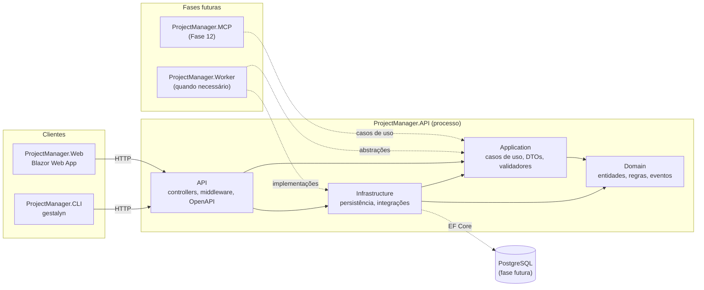
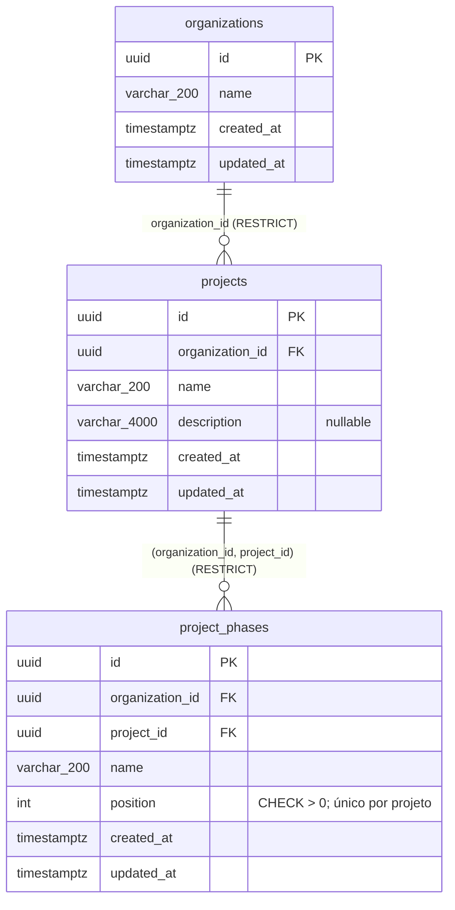

# Arquitetura do Gestalyn

> Estado: Fase 01 (fundação técnica). Fonte de verdade: [Especificação mestre](../specifications/ESPECIFICACAO-MESTRE.md). Decisão de base: [ADR-001: Monólito modular](../decisions/ADR-001-MODULAR-MONOLITH.md).

## 1. Visão geral

O Gestalyn (nome de trabalho no código: ProjectManager) é um **monólito modular** em .NET 10. Um único processo de API concentra as regras de negócio e a persistência. A interface Web e a CLI `gestalyn` consomem a API **exclusivamente por HTTP**. O futuro servidor MCP acessará os casos de uso pela camada Application, ou por contratos próprios, sem duplicar regras de negócio. O futuro Worker usará abstrações da Application e implementações da Infrastructure.

## 2. Camadas e dependências

| Projeto | Depende de | Responsabilidade |
|---|---|---|
| `Domain` | — | Entidades, objetos de valor, enums, eventos de domínio, interfaces de domínio, regras de negócio. |
| `Application` | `Domain` | Casos de uso, serviços de aplicação, DTOs, validadores, interfaces de serviços implementadas pela infraestrutura. |
| `Infrastructure` | `Application`, `Domain` | EF Core/PostgreSQL, Identity, integrações externas (GitHub, IA), relógio, e-mail etc. |
| `API` | `Application`, `Infrastructure` | Composição (DI), controllers, middleware, OpenAPI, tratamento de erros, health checks. |
| `Web` | API via HTTP | Interface Blazor. Não acessa banco nem camadas internas. |
| `CLI` | API via HTTP | Interface de terminal `gestalyn`. Não implementa regras de negócio. |
| `MCP` *(Fase 12)* | `Application` (ou contratos próprios) | Servidor MCP para agentes. Usa os mecanismos de autenticação e autorização aprovados e não duplica regras de negócio. |
| `Worker` *(quando necessário)* | `Application`, `Infrastructure` | Processamento em segundo plano. |

**Regra da dependência:** as setas apontam para o núcleo. `Domain` não conhece nenhuma outra camada; `Application` conhece apenas `Domain`. As regras são verificadas por `ProjectReferenceRulesTests` em toda execução de `dotnet test`.

**Por que Web e CLI não referenciam projetos internos:** garante que todo acesso a dados passe pelas mesmas regras de autorização, validação e multi-tenancy da API. Também permite implantar a Web separadamente e mantém a CLI e os agentes como clientes equivalentes a qualquer integração externa.

**MCP e Worker:** quando forem criados, entram em `ProjectReferenceRulesTests` com as dependências acima.

## 3. Multi-tenancy (decisão aprovada)

Conforme a seção 2.3 da especificação mestre, implementado a partir da Fase 02 ([ADR-003](../decisions/ADR-003-ISOLAMENTO-MULTI-TENANT.md)):

- Banco PostgreSQL e schema **compartilhados**, com isolamento lógico.
- Identificadores **UUID**.
- `OrganizationId` em toda entidade pertencente a uma organização.
- Relacionamentos que impedem associações entre organizações diferentes.
- A organização ativa é validada no backend a partir da identidade e das permissões do usuário ou agente autenticado. **Nunca** se confia apenas no `OrganizationId` enviado pelo cliente.
- Testes automatizados de isolamento cross-tenant.
- Row-Level Security do PostgreSQL pode ser adotado como camada adicional, após avaliação técnica registrada em ADR (avaliado no ADR-003; reavaliação na Fase 04 ou 13).

### 3.1 Como o isolamento é garantido

| Camada | Mecanismo | Onde |
|---|---|---|
| Leitura | Filtro global `OrganizationId == organização ativa` em toda entidade `IOrganizationOwned`, e `Id == organização ativa` em `Organization`. Sem organização ativa, nada é retornado. | `ProjectManagerDbContext.OnModelCreating` |
| Gravação | Inserção, alteração ou exclusão fora da organização ativa lança `CrossTenantAccessException`. `OrganizationId` é imutável. | `Persistence/ChangeTracking/TenantIsolationRules` |
| Banco | FK composta `(organization_id, <pai>_id)` → `(organization_id, id)` | Configurações EF e migration |

A organização ativa vem de `ITenantContext` (Application). Até a Fase 04, o padrão é `UnresolvedTenantContext` (nenhuma organização ativa).

### 3.2 Modelo persistido (Fase 02)

- `projects` tem a chave alternativa única `(organization_id, id)`, alvo das FKs compostas.
- Todas as tabelas usam `xmin` como token de concorrência otimista ([ADR-002](../decisions/ADR-002-PERSISTENCIA-EF-CORE-POSTGRESQL.md)).
- Entidades mínimas: os demais atributos de projetos e fases entram nas Fases 05 e 06.

## 4. Módulos (evolução prevista)

A modularização será **vertical por contexto de negócio** dentro de cada camada (por exemplo `Application/Projects`, `Application/Tasks`, `Infrastructure/Persistence/Projects`). Cada módulo expõe seus casos de uso pela camada `Application` e não acessa diretamente os dados de outro módulo. A comunicação entre módulos ocorre por interfaces de aplicação ou eventos de domínio.

Módulos previstos (especificação mestre, seção 4): identidade e organizações, autorização, projetos, tarefas, fluxos de trabalho configuráveis, auditoria e documentação, e agentes de IA.

## 5. Aspectos transversais implementados na Fase 01

### 5.1 API

- **Composição:** `Program.cs` registra `AddApplication()` e `AddInfrastructure()`, os pontos de composição de cada camada.
- **Erros:** `AddProblemDetails()` + `GlobalExceptionHandler` (`IExceptionHandler`). Exceções não tratadas viram `500 application/problem+json` com `traceId`, sem mensagem ou tipo da exceção. Requisições canceladas pelo cliente retornam `499` e não são registradas como erro. Respostas sem corpo (como 404) também viram Problem Details via `UseStatusCodePages()`.
- **OpenAPI:** documento nativo do .NET 10 (OpenAPI 3.1) em `/openapi/v1.json`, exposto **somente em Development**.
- **Health check:** `/health` com resposta JSON (`status`, `version`, `checkedAt`, `checks[]`). Registra `self` (processo em execução) e, desde a Fase 02, `database` (conexão com o PostgreSQL, registrada pela Infrastructure). Retorna 200 para Healthy/Degraded e 503 para Unhealthy, sem expor detalhes de exceções ou da conexão.
- **Banco:** connection string `ConnectionStrings:ProjectManager` obrigatória, validada na inicialização; a API não sobe sem ela.
- **HTTPS/HSTS:** aplicados fora de Development.

### 5.2 Web

- Blazor Web App com renderização **estática no servidor (SSR) por padrão** e **Interactive Server** por componente quando há interatividade.
- `ApiOptions` (`Api:BaseUrl`, `Api:TimeoutSeconds`) com validação na inicialização: fora de Development a aplicação não sobe sem a URL da API.
- `ApiHealthClient`: `HttpClient` tipado via `IHttpClientFactory`. Erros de rede, timeout e resposta inválida são tratados explicitamente e registrados.
- Tema escuro com Bootstrap 5.3 (`data-bs-theme="dark"`) e tokens CSS próprios em `wwwroot/app.css`.

### 5.3 CLI

- `System.CommandLine` 2.x. `CliApplication` monta o comando raiz e executa com saída injetável (testável).
- `--help`, `--version` (versão do assembly) e ajuda quando executada sem argumentos. Comando desconhecido retorna código de saída ≠ 0.
- Convenção para os grupos futuros: `Commands/<Grupo>/<Grupo>Command.cs`, registrados em `CliApplication.CreateRootCommand()`. Grupos previstos: `auth`, `organization`, `project`, `task`, `activity`, `phase`, `agent`. **Nenhum foi registrado** porque ainda não há implementação real.
- Autenticação futura (Fase 11): o grupo `auth` obtém as credenciais, que ficam armazenadas de forma segura no sistema operacional. A CLI oferecerá saída legível e saída JSON para agentes.

### 5.4 Logging

- `Microsoft.Extensions.Logging` com mensagens estruturadas via `[LoggerMessage]`.
- Console em **JSON** fora de Development (pronto para agregadores de logs na nuvem) e formato simples de linha única em Development. A troca é feita somente por configuração (`Logging:Console:FormatterName`).

### 5.5 Versionamento

A versão é definida uma única vez em `Directory.Build.props` (`VersionPrefix`) e exposta pela API (`/health`), pela Web (página de status) e pela CLI (`--version`).

## 6. Próximas decisões, por fase

Os temas abaixo foram decididos em linhas gerais pela especificação mestre. O detalhamento técnico será registrado em ADR na fase indicada.

| Tema | Fase |
|---|---|
| ~~Modelo de domínio inicial, PostgreSQL + EF Core, migrations, auditoria de persistência, health check do banco~~ (ADR-002, 003 e 004) | 02 (concluída) |
| Autor das alterações (`CreatedBy`/`UpdatedBy`) e reavaliação de RLS | 03/04 |
| Estratégia de sessão da Web e autenticação da API (ASP.NET Core Identity) | 03 |
| Papéis, permissões e organização ativa | 04 |
| Credenciais de agentes, escopos e idempotência | 10 |
| Armazenamento seguro de credenciais na CLI | 11 |
| Servidor MCP | 12 |
| SignalR, quando houver necessidade real | 09 |
| Provedor cloud, object storage S3, observabilidade e implantação | 14 |
