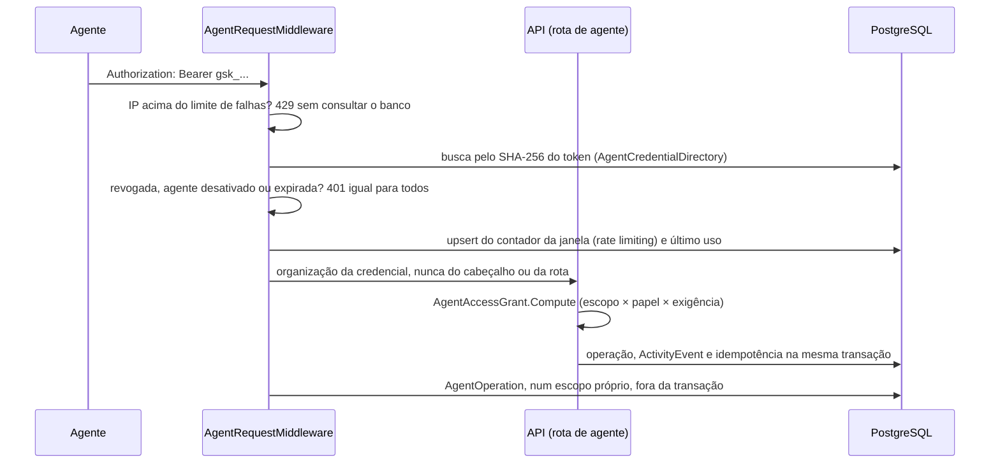

# Segurança: agentes e credenciais

Modelo de segurança dos agentes da Fase 10. As decisões e as alternativas estão no [ADR-016](../decisions/ADR-016-AGENTES.md) e o detalhamento na [especificação da Fase 10](../specifications/FASE-10-AGENTES.md). A autenticação de pessoas continua em [AUTENTICACAO.md](AUTENTICACAO.md).

## Visão geral

Um agente é uma integração da organização (um assistente de código, um CI, um script) com credenciais próprias. Ele nunca usa a sessão de uma pessoa e só alcança as rotas `/api/v1/agents/*`.

- **Token:** `gsk_` seguido de 43 caracteres base64url (256 bits aleatórios). O banco guarda só o SHA-256 e um prefixo de 8 caracteres. A Web mostra o prefixo como `gsk_xxxxxxxx…`.
- **Credencial:** nome, escopos (`context:read`, `tasks:read`, `tasks:write`, `activities:write`, `reports:write`), expiração obrigatória de 1 a 365 dias (padrão de 90), revogação e último uso. Um agente tem até 3 credenciais ativas.
- **Acesso a projetos:** concessão explícita por projeto, com o papel Colaborador ou Observador. Conceder exige `agents.manage` na organização e `project.members.manage` no projeto.
- **O que um agente nunca faz:** aprovar uma transição, entrar num estado da categoria Concluída (inclusive por um atalho de workflow personalizado), receber `tasks.approve` ou o papel Gerente, ou alcançar rotas de pessoas.

## Ameaças e mitigações

| Ameaça | Mitigação | Evidência |
|---|---|---|
| Token de agente usado nas rotas de pessoas, ou JWT nas de agentes | Políticas explícitas `User` e `Agent`, sem esquema padrão; teste de política em todos os endpoints; `[AgentApi]` só sob `/api/v1/agents` (a API não inicia com uma marca incoerente) | `EachScheme_WorksOnlyOnItsOwnRoutes`, `EndpointPolicyTests`, `AgentPolicyMarkerTests` |
| Vazamento do token no banco ou no log | Só o hash e o prefixo no banco; nenhum log com token, prefixo ou hash; `AgentOperation` sem cabeçalhos nem corpos | `Credential_TokenIsShownOnlyOnCreation_AndOnlyTheHashAndPrefixAreStored`; o teste de ponta a ponta procura o token em todas as tabelas e no log |
| Vazamento do token pela Web | Aparece uma única vez, na resposta do formulário de criação, sem redirecionamento; `Cache-Control: no-store` em todas as telas de agentes; fora de URL, aviso, sessão, cookie e armazenamento do navegador | `CreatingACredential_ShowsTheTokenOnce_...`, `NoStoreHeader_CoversEveryAgentPage_...`; execução real da etapa 11 |
| Credencial roubada | Revogação e desativação do agente valem na requisição seguinte; expiração obrigatória; escopos mínimos; rate limiting | `RevocationAndDisabling_TakeEffectOnTheNextRequest_...`, `ExpiredCredential_IsRejected`; mutações de revogação e de expiração detectadas |
| Enumeração de credenciais | Token inexistente, malformado, adulterado, revogado, expirado ou de agente desativado: o mesmo 401, sem dados | `EveryRejection_IsIndistinguishable_AndRevealsNothingAboutTheCredential`, `MalformedTokens_AreRejected`, `TamperedToken_IsRejected` |
| Força bruta de tokens | Limite de falhas por IP em memória (30 por minuto, até 100.000 IPs), antes de qualquer consulta ao banco | `UnknownTokens_AreLimitedPerAddress_BeforeAnyLookup` |
| Abuso por um agente legítimo | Rate limiting por credencial no PostgreSQL (120 por minuto), com um upsert atômico; 429 com `Retry-After` | `RateLimit_Returns...`, `RateLimit_IsAtomicUnderConcurrency` |
| Acesso a outra organização | Organização só da credencial; cabeçalho ou rota divergente: 404; filtro global de leitura; FKs compostas | `AgentIsolationTests`, `Organization_ComesOnlyFromTheCredential`; mutação "aceitar a organização do cabeçalho" detectada |
| Acesso a projeto não concedido | `AgentAccessGrant.Compute` é a única regra; projeto não concedido ou de outra organização: 404; sem o escopo ou com papel insuficiente: 403 | `EveryReadRoute_IsNotFound_...`, `Writes_AreRefusedByVisibilityRoleAndScope`; unitários de escopo × papel |
| Agente aprovando ou concluindo o próprio trabalho | Regra em `TransitionRules` (não na rota), também nas transições disponíveis; `tasks.approve` fora das permissões elegíveis | `Transitions_UseTheSameRules_AndTheAgentNeverApprovesNorEntersDone`, `CustomWorkflow_OffersAgentsNeitherApprovalNorDone_...`, teste de ponta a ponta; mutações detectadas |
| Operação duplicada por repetição | `Idempotency-Key` obrigatória em todo `POST`; reserva, operação e resposta na mesma transação, com trava consultiva; hash do método, do caminho, da query e do corpo; reautorização antes do replay | `AgentIdempotencyTests`; mutações "replay sem reautorizar" e "pular o hash do corpo" detectadas |
| Sobrescrita concorrente | `expectedVersion` obrigatória para agentes; 409 sem sobrescrever | `Patch_RequiresTheExpectedVersion_...`, `ConcurrentEdits_WithTheSameVersion_ExactlyOneWins` |
| Autoria forjada ou alterada | `CHECK` de autor único, gatilho de autoria imutável, FK do agente na mesma organização | `Database_RequiresExactlyOneAuthor_...`; mutação do `CHECK` detectada |
| Relatório adulterado | `work_reports` sem `UPDATE`, `DELETE` e `TRUNCATE` no banco; os níveis de evidência separados; o estado da tarefa não muda | `Reports_AreImmutableInTheDatabase`, `Submit_SeparatesTheLevels_AndLeavesTheTaskUnchanged` |
| Apagar rastros | `agent_operations` sem `UPDATE` e `TRUNCATE`; `DELETE` só de linhas com mais de 180 dias, no gatilho; a API recusa iniciar com retenção menor | `Database_RefusesToDeleteOrChangeRecentOperations`, `Api_RefusesToStart_WithARetentionShorterThanTheTrigger` |
| Auditoria indisponível derrubando a API | Gravação da operação fora da transação; falha vira log de erro e `agents-audit` em `Degraded` | `AuditFailure_NeverBreaksTheRequest_AndDegradesTheHealthCheck` |

## Exceções de isolamento

As únicas consultas sobre dados de organizações fora do filtro global são as listadas no ADR-016 e no AGENTS.md:
- `AgentCredentialDirectory`: busca da credencial pelo hash do token;
- o upsert do rate limiting de agentes;
- a trava consultiva da idempotência;
- a limpeza de retenção do `AgentRetentionService`.

## Configuração

| Chave | Padrão | Observação |
|---|---|---|
| `RateLimiting:Agents:PermitLimit` / `WindowSeconds` | 120 / 60 | Por credencial, no PostgreSQL; validado na inicialização |
| `RateLimiting:AgentAuthFailures:PermitLimit` / `WindowSeconds` / `MaxTrackedAddresses` | 30 / 60 / 100.000 | Por IP, em memória e por instância. Atrás de um proxy, depende dos forwarded headers (Fase 14) |
| `Agents:Retention:OperationRetentionDays` | 180 | Não pode ser menor que o prazo do gatilho (180) |
| `Agents:Retention:IdempotencyRetentionDays` | 7 | Registros de idempotência |
| `Agents:Retention:Interval` / `InitialDelay` / `BatchSize` | 1 h / 1 min / 1.000 | Ciclo da limpeza |

Nenhuma dessas chaves é secreta. O token de um agente é um segredo do cliente que o usa: guarde-o num cofre de segredos e nunca no repositório.

## Operação

- **Provisionar:** em **Agentes**, crie o agente, crie uma credencial com os escopos mínimos e a menor validade razoável, copie o token na mesma tela e conceda os projetos.
- **Rotacionar:** crie uma credencial nova, troque o token no cliente e revogue a antiga. Até 3 credenciais ativas permitem a troca sem interrupção.
- **Token perdido ou exposto:** revogue a credencial imediatamente; ela deixa de valer na requisição seguinte. O token não pode ser recuperado.
- **Suspender um agente:** desative-o; nenhuma credencial dele vale até a reativação, e credenciais revogadas ou expiradas continuam sem valer.
- **Investigar:** a tela de operações do agente mostra cada requisição, inclusive as recusadas, com o modelo da rota, o resultado da autorização, o código da recusa e o `correlation_id`, por 180 dias.
- **Monitorar:** os health checks `agents-audit` e `agents-retention` ficam em `Degraded` quando a gravação da auditoria falha ou quando a limpeza não roda há mais de 3 intervalos.

## Pendências de segurança (fases futuras)

- **Fase 12:** verificação de testes e CI dos relatórios (`work_report_verifications`).
- **Fase 13:** medição da latência adicional por requisição de agente (busca do hash, contador e gravação da operação) e testes de carga do rate limiting.
- **Fase 14:** forwarded headers para o limite por IP atrás de proxy e um limite compartilhado entre instâncias, se houver mais de uma.
