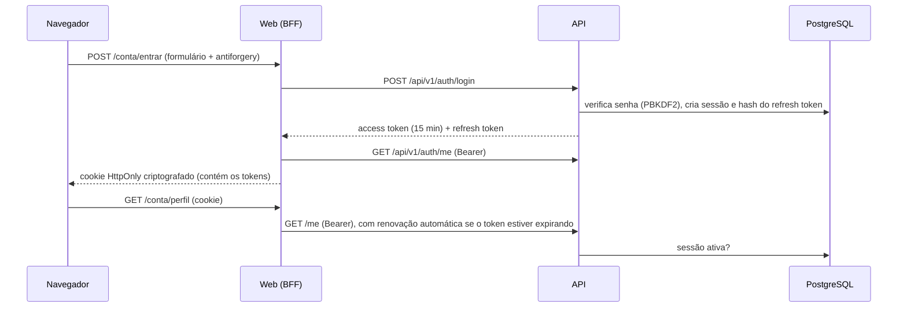

# Segurança: autenticação e sessões

Modelo de segurança da Fase 03. As decisões e alternativas estão no [ADR-006](../decisions/ADR-006-AUTENTICACAO-E-SESSAO.md) e no [ADR-007](../decisions/ADR-007-ENVIO-DE-EMAIL.md).

## Visão geral

## Ameaças e mitigações

| Ameaça | Mitigação | Evidência |
|---|---|---|
| Força bruta de senha | Lockout (5 falhas / 15 min) e rate limiting por IP (429) | Testes `Lockout_AfterFiveFailures...` e `AuthEndpoints_AreRateLimitedPerClient` |
| Enumeração de contas | Respostas idênticas no login, cadastro e recuperação; hash fictício para igualar o tempo; e-mail não confirmado informado só com a senha correta | `Login_UnknownEmailAndWrongPassword_ReturnIdenticalResponses`, `Register_ExistingEmail...`, `ForgotPassword_UnknownEmail...` |
| Roubo de access token | Validade de 15 min; logout e redefinição revogam a sessão imediatamente | `Logout_InvalidatesAccessAndRefreshTokensImmediately`; mutação detectada |
| Roubo de refresh token | Uso único com rotação; reuso revoga a sessão; só o hash é armazenado | `RefreshTokenReuse_RevokesTheWholeSession`, `RefreshTokenHash_...` |
| Token forjado ou adulterado | HS256 com chave de pelo menos 256 bits; algoritmo, emissor e público validados | `AccessTokenSignedWithAnotherKey...`, `TamperedAccessToken...`, `ExpiredAccessToken...` |
| XSS roubando tokens na Web | Tokens nunca chegam ao navegador; cookie `HttpOnly` | `document.cookie` vazio e HTML sem JWT (verificação manual) |
| CSRF | Formulários e logout com antiforgery; cookie `SameSite=Lax`; logout só por POST | Middleware de antiforgery do Blazor |
| Open redirect após login | `ReturnUrl` aceito só se for local | `ReturnUrls.Sanitize` |
| Vazamento em logs | Mensagens de log sem senha, token ou e-mail (só IDs de usuário) | `Logs_NeverContainPasswordsOrTokens` |
| Contas com e-mail de terceiros | Confirmação de e-mail obrigatória antes do login | `Register_ConfirmEmail_Login_Me...` (403 antes da confirmação) |
| Cadastros simultâneos com o mesmo e-mail | Índice único em `users.normalized_email` | Migration `AddIdentityAndSessions` |
| Links de e-mail reutilizados | Tokens de 2 h; o token de redefinição expira ao mudar a senha | `ResetToken_CannotBeUsedTwice` |

## Configuração sensível

| Chave | Onde fica | Observação |
|---|---|---|
| `Authentication:Jwt:SigningKey` | user-secrets (dev) · variável de ambiente ou cofre (demais ambientes) | Mínimo de 32 bytes; a API não inicia sem ela. Gere com `openssl rand -base64 48`. |
| `ConnectionStrings:ProjectManager` | idem | — |
| `Email:UserName` / `Email:Password` | idem | Vazios em desenvolvimento (Mailpit) |

Trocar a `SigningKey` invalida todos os access tokens emitidos. As sessões continuam válidas e são renovadas com o refresh token.

## Pendências de segurança (fases futuras)

- **Fase 14:** repositório compartilhado de chaves do Data Protection (cookies da Web e links de e-mail) e forwarded headers para o rate limiting atrás de proxy.
- **Fase 13:** cache da validação de sessão (desempenho), testes de carga do rate limiting e reavaliação de 2FA e passkeys.
- **Fase 10:** credenciais de agentes, separadas das de usuários.
